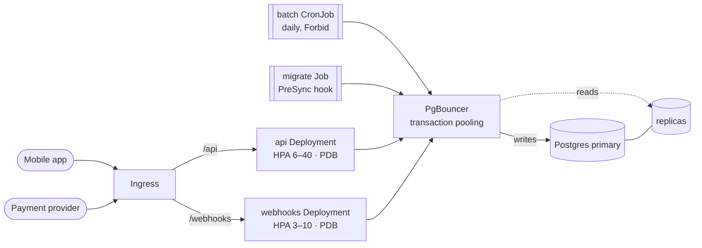
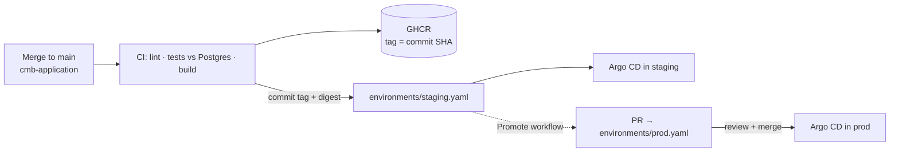

# cmb-deployment

[](https://github.com/vbezbakh/cmb-deployment/actions/workflows/validate.yml)
[](https://github.com/vbezbakh/cmb-application/actions/workflows/ci.yml)

Kubernetes deployment for a FastAPI service on the mobile app's critical path: ~3k req/s at the evening peak, payment webhooks, a daily batch job, and a Postgres that lives outside the cluster.

The application code lives in **[cmb-application](https://github.com/vbezbakh/cmb-application)**. This repo is everything needed to run it: a Helm chart, per-environment values, GitOps with Argo CD, CI that proves it all works, and a one-command local environment to try it.

> [!TIP]
> **Reviewers, start here**
> 1. **[docs/DECISIONS.md](docs/DECISIONS.md)**: the decisions, the delivery and monitoring write-up, assumptions, what I left out, and open questions.
> 2. **[chart/cmb-app](chart/cmb-app)**: the deliverable. [`values.yaml`](chart/cmb-app/values.yaml) is commented line by line; [`environments/`](environments) shows what differs per environment.
> 3. **[Run it yourself](#run-it-in-5-minutes)**, then [break it](#break-it-yourself).
>
> Everything under `argocd/`, `database/` and `scripts/` is the **local harness** that makes the chart demonstrable on a laptop. In production, Postgres is the managed database and Argo CD is the platform's.

---

## Architecture



- **Two workloads from one image.** A mobile traffic spike can't starve payment webhooks, and each scales, rolls out and alerts on its own.
- **No dropped requests** on deploys, scale-down or node drains: `maxUnavailable: 0`, a native `preStop` sleep, uvicorn draining inside a 45s grace period, keep-alive tuned against the ingress.
- **Probes that don't cascade.** Liveness and readiness never check the database, so a DB blip returns quick 503s instead of pulling every pod out of the load balancer at once.
- **Connection-safe at peak.** 40 pods × their pools would overwhelm Postgres; PgBouncer multiplexes them, and the app is built for transaction pooling.
- **Payments are exactly-once in effect.** HMAC signatures with replay protection, idempotent storage keyed on the provider's event id.
- **Batch and migrations are safe to retry**: idempotent upserts and advisory locks.

## Delivery



- **Clusters pull, CI never pushes to a cluster.** Argo CD watches this repo; a deploy is a commit.
- **Staging gets every merge automatically.** CI in `cmb-application` commits the new image tag and digest here.
- **Prod moves only through a reviewed PR.** The **Promote** workflow (Actions → Promote → Run) copies the exact image from staging to prod and links the application diff. Nothing is rebuilt. Rollback is reverting that PR.
- **Every PR here is proven**: the chart is rendered for each environment, validated against Kubernetes 1.34 and CRD schemas, then installed into a throwaway kind cluster with a real Postgres and smoke-tested end to end.

## Run it in 5 minutes

**Needs:** Docker (or Colima) with ~6 GB of memory, `minikube`, `kubectl`, `helm`, `openssl`.

```bash
git clone https://github.com/vbezbakh/cmb-deployment && cd cmb-deployment
./scripts/bootstrap.sh
```

What it does, step by step:

| Step | |
|---|---|
| 1 | Starts minikube (Kubernetes 1.34) with the ingress and metrics-server addons. |
| 2 | Generates the database password and webhook signing secret into Kubernetes Secrets. Nothing secret is in Git. |
| 3 | Installs Argo CD from its pinned Helm chart. |
| 4 | Applies **one** object, [`argocd/root.yaml`](argocd/root.yaml). From here Git is in charge. |
| 5 | Argo CD syncs in waves: CloudNativePG operator → Postgres (primary + replica) + PgBouncer → the app (migration first). |
| 6 | Runs [`scripts/smoke-test.sh`](scripts/smoke-test.sh) through the ingress. |

`./scripts/teardown.sh` deletes everything.

## Break it yourself

Each demo is one command against the local cluster. Load is generated **inside** the cluster with fortio and goes through the ingress, like real traffic.

| Demo | What you'll see |
|---|---|
| [`scripts/demo/rollout-under-load.sh`](scripts/demo/rollout-under-load.sh) | Every API pod is replaced while 50 req/s flow through the ingress: **100% HTTP 200**. |
| [`scripts/demo/db-failover.sh`](scripts/demo/db-failover.sh) | The Postgres primary is deleted under write load. A replica is promoted in seconds; the app answers a short burst of 503 + `Retry-After` (never 500) and **no app pod restarts**. |
| [`scripts/demo/webhooks.sh`](scripts/demo/webhooks.sh) | A valid delivery is accepted, a redelivery is deduplicated, and tampered, wrongly signed and replayed deliveries are rejected, all counted in `/metrics`. |
| [`scripts/demo/autoscale.sh`](scripts/demo/autoscale.sh) | Unthrottled load drives CPU up and the HPA scales the API out. |
| [`scripts/demo/batch.sh`](scripts/demo/batch.sh) | The daily job is run twice for the same day and produces the same rows. |

To ship a change and watch it roll out: merge to `cmb-application` main, wait for CI to commit the new tag here, then watch Argo CD (`kubectl -n argocd port-forward svc/argocd-server 8443:80`) roll it out within a minute.

## Repository layout

```
chart/cmb-app/            Helm chart: Deployments, Services, HPAs, PDBs, Ingress, CronJob,
                          migration hook, ExternalSecret, ServiceMonitor, PrometheusRule
environments/             local.yaml · staging.yaml · prod.yaml (image pin + what differs)
argocd/                   Argo CD install values, root app-of-apps, child apps (sync waves)
database/local/           CloudNativePG Cluster (1 primary, 1 replica) + PgBouncer Poolers
scripts/                  bootstrap, teardown, smoke test, demos
docs/DECISIONS.md         decisions, delivery, monitoring, assumptions, open questions
.github/workflows/        validate (lint, schemas, kind smoke test), promote (staging → prod PR)
```

## Versions

Kubernetes 1.34 · Helm chart API v2 · Argo CD 3.5.6 (chart 10.11.6) · CloudNativePG 1.30.1 (chart 0.29.1) · Python 3.14 · PostgreSQL 18
