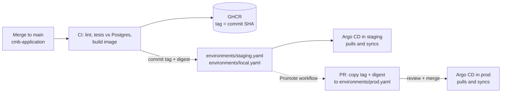

# Decisions, assumptions and open questions

The service: a FastAPI app on port 8000, on the critical path for the mobile app, ~2–3k req/s in the evening and ~10% of that overnight. It reads and writes a managed Postgres outside the cluster, receives payment webhooks, and runs a daily batch job.

The short version of what I optimised for, in order:

1. **No dropped requests during normal operations** (deploys, scale-down, node drains, a database failover).
2. **Payments are never lost or double counted**, even when everything else is on fire.
3. **The database survives the evening peak**, which in practice means controlling connection count.
4. **A boring, reviewable path to prod**: every change is a Git commit, prod only moves through a reviewed PR.

---

## What gets deployed

| Object | Why |
|---|---|
| `Deployment` **api** + HPA + PDB | Mobile traffic. Scales 6 → 40 pods on CPU. |
| `Deployment` **webhooks** + HPA + PDB | Payment provider callbacks. Same image, separate pods. |
| `CronJob` **batch** | Daily job, `concurrencyPolicy: Forbid`. |
| `Job` **migrate** (pre-install/pre-upgrade hook) | Schema migrations before new code starts. |
| `Ingress` | Only `/api` and `/webhooks` are public. `/metrics`, `/docs`, `/healthz/*` are not routed. |
| `ExternalSecret` (staging/prod) | DB URLs and the webhook signing secret come from the cloud secret manager. |
| `ServiceMonitor` + `PrometheusRule` (staging/prod) | Scraping and alerts, defined next to the app. |

---

## Key decisions

### 1. One image, two Deployments: `api` and `webhooks`

The same image runs as either workload; `COMPONENT` decides which routes a pod even registers (an API pod returns 404 for `/webhooks/*` and vice versa).

**Why:** a mobile traffic spike or a bad API deploy must not starve payment webhooks of workers or connections. Separate Deployments give separate scaling, separate rollouts, separate PDBs, separate DB pool budgets and separate alerts. The cost is one more Deployment, which is cheap.

### 2. Probes that don't take the whole service down

- **Liveness** (`/livez`) checks only that the process and event loop respond. Never the database.
- **Readiness** (`/readyz`) checks that start-up finished. It deliberately **does not ping the database** on every probe.
- **Startup** allows 90s, longer than the app's 60s database connect-retry window.

**Why:** if readiness depended on the database, a 5-second DB blip would mark *every* pod unready at the same moment, the ingress would have no endpoints, and recovery would wait for the next probe round. Instead pods stay in rotation and answer **503 + `Retry-After: 1`** for database errors (never 500), and recover the instant the database does. A database check exists at `/healthz/dependencies` for dashboards and humans, not for kubelet.

### 3. Zero-downtime rollouts and shutdowns

| Setting | Value | Reason |
|---|---|---|
| `maxUnavailable` | 0 | Never drop below current capacity mid-rollout. |
| `preStop: sleep` | 10s | Endpoint removal is asynchronous; keep serving while the ingress catches up. Uses the native sleep action, no shell in the image. |
| uvicorn graceful shutdown | 25s | Drain in-flight requests after SIGTERM. |
| `terminationGracePeriodSeconds` | 45 | 10 + 25 + headroom. |
| uvicorn keep-alive | 75s | Longer than ingress-nginx's 60s upstream keep-alive, otherwise the proxy occasionally reuses a connection the app just closed and returns a 502. |

The rollout demo (`scripts/demo/rollout-under-load.sh`) restarts every API pod under 50 req/s and shows 100% HTTP 200.

### 4. Autoscaling and sizing

- **One uvicorn worker per pod.** Kubernetes scales pods, not processes inside a pod. CPU requests stay honest (one Python process uses at most ~1 core), probes and restarts apply to exactly one process, and Prometheus needs no multiprocess workaround.
- **HPA on CPU at 60%**, scale up fast (+100% or +4 pods every 30s, no stabilisation window) for the evening ramp, scale down slowly (10%/min after 5 min) so dips don't cause flapping.
- **Prod: min 6 (2 per zone), max 40.** This assumes roughly **200 req/s per pod** at the 60% target, so ~15–20 pods at the 3k req/s peak with headroom to 40. **That number is an assumption and must be confirmed by a load test** before go-live.
- **CPU request but no CPU limit.** CFS throttling on a single-threaded Python server shows up as unexplained latency spikes. Memory is limited.
- **Zone spread is a hard requirement in prod** (`DoNotSchedule`), soft elsewhere.

### 5. Database connections (the real scaling limit)

Each pod keeps its own pool, so connections grow with replicas: at max scale that's 40 × 10 (API) + 10 × 5 (webhooks) = **450 connections**, plus batch and migrations. Most managed Postgres tiers would fall over long before that.

- **PgBouncer in transaction mode** multiplexes those onto a small server-side pool (20). Locally it's a CloudNativePG `Pooler`; in prod it's either the provider's pooler or PgBouncer in the cluster (open question below).
- Because of transaction pooling, the app **disables named prepared statements** (`DB_STATEMENT_CACHE_SIZE=0`) and uses **transaction-scoped advisory locks** only.
- **Reads that tolerate lag** (the list endpoint) go to a read-replica pool; **read-your-own-write** paths stay on the primary.
- **Pool acquire timeout of 2s**: under overload a request fails fast with 503 instead of queueing forever.

### 6. Payment webhooks

- **Verify before parsing**: HMAC-SHA256 over `timestamp.body`, constant-time compare, and a **5-minute timestamp tolerance** to reject replays.
- **Secret rotation without downtime**: the app accepts a comma-separated list of secrets and any of several `v1` signatures.
- **Idempotent**: the provider's event id is the primary key; a redelivery returns 200 `duplicate` and is not stored twice.
- **Acknowledge fast**: the handler only stores the event; anything slow happens later. Providers time out and retry slow endpoints.
- **Body limit** (256 KB) in the app; the ingress can enforce one too.

### 7. Daily batch job

- `CronJob` with `concurrencyPolicy: Forbid`, `startingDeadlineSeconds: 3600` (a slot missed during a control-plane upgrade still runs), `backoffLimit: 2`, and failed pods kept for their logs.
- **Idempotent**: an upsert keyed by `(day, event_type)`. Retries and manual re-runs recompute the same rows. `--date` allows backfills.
- **Overlap-safe**: Kubernetes documents that a CronJob can occasionally create two Jobs for one slot. The job takes a **transaction-scoped advisory lock** and exits cleanly if another run holds it.
- Failures and missed runs are visible through kube-state-metrics, so the job needs no push gateway.

### 8. Migrations

A Helm `pre-install,pre-upgrade` hook, which Argo CD runs as **PreSync**: Deployments only change after the migration succeeds. All pending migrations run **in one transaction under an advisory lock**, so a failed migration changes nothing and two concurrent runs can't interleave. The rule that makes this safe with rolling updates is **expand/contract**: a migration must work with the version still serving traffic.

### 9. Secrets

Nothing secret is in Git. Real clusters use **External Secrets**; the `ExternalSecret` is itself a hook ordered before the migration so the Secret exists on the very first deploy. Locally `scripts/create-secrets.sh` generates random values. Each workload only receives the keys it needs (the API never sees the webhook signing secret).

### 10. Images

- Built once per commit, **tagged with the full commit SHA** and **pinned by digest** in every environment, so a re-pushed tag can never change what's running and "what's in prod" maps to exactly one commit.
- Non-root (uid 10001), read-only root filesystem, all capabilities dropped, `RuntimeDefault` seccomp, no service account token mounted.
- GitHub Actions are pinned by commit SHA; Dependabot keeps actions, base image and Python dependencies current.

### 11. Helm (rather than Kustomize)

The two workloads differ only in a few values, so a loop over `workloads:` in one chart keeps them consistent. Environment differences live in small values files that are easy to diff in a promotion PR. Argo CD renders the chart itself (`helm template`), so Git, not Helm's release history, is the source of truth; rollback is `git revert`.

---

## Delivery

1. **Merge to `cmb-application` main** → CI lints, runs the tests against a real Postgres, builds the image and pushes it to GHCR tagged with the commit SHA.
2. **CI commits the new tag + digest** to `environments/staging.yaml` (and `local.yaml`) in this repo.
3. **Argo CD in each cluster pulls** this repo and syncs. The cluster pulls; CI never holds cluster credentials. Migrations run first (PreSync), then a rolling update.
4. **Promotion to prod** is the `Promote` workflow: it opens a PR that copies the *exact* tag + digest from staging to prod, with a link to the diff of application changes. Merging is the approval; nothing is rebuilt, so prod runs the bytes staging tested.
5. **Rollback** is reverting that PR (or the staging bump). Argo CD converges within a minute.

Every pull request to this repo renders the chart for every environment, validates it against Kubernetes 1.34 and CRD schemas, and installs it into a throwaway kind cluster with a real Postgres for an end-to-end smoke test.

**Next steps I'd take for prod delivery:** replace the cross-repo personal access token with a GitHub App; protect `environments/prod.yaml` with CODEOWNERS and required reviews; add Argo CD notifications to the team channel; and move to progressive delivery (Argo Rollouts canary gated on the same error-rate and latency queries the alerts use).

---

## Monitoring

**Signals the service exposes:**

- RED metrics per route template: `http_requests_total{method,route,status}`, `http_request_duration_seconds` histogram, in-flight requests.
- `payment_webhooks_total{outcome}`: accepted, duplicate, rejected by reason.
- DB pool usage (`db_pool_connections`, `db_pool_max_connections`) and `db_unavailable_errors_total`.
- `app_info{version}` to correlate behaviour with deploys.
- JSON logs with a request id (propagated from `X-Request-ID` or generated, and returned to the client).
- Platform signals: kube-state-metrics (replicas, restarts, HPA, CronJob/Job status) and database metrics from the provider.

**Targets (to agree with the product team):** API availability **99.9%** of requests succeed, p99 latency **< 1s**.

### Page someone at 3am vs look at it in the morning

All defined as code in [`chart/cmb-app/templates/prometheusrule.yaml`](../chart/cmb-app/templates/prometheusrule.yaml).

| Alert | Severity | Condition | Why it's urgent (or not) |
|---|---|---|---|
| API error budget burning fast | **page** | >1.44% 5xx over both 1h and 5m | Users are failing now; at this rate the month's budget is gone in ~2 days. Two windows: fast to fire, quick to clear. |
| API p99 latency high | **page** | p99 > 1s for 10 min | The app feels broken even if requests succeed. |
| API capacity low | **page** | < 50% of desired replicas available for 5 min | One more failure away from an outage. |
| Payment webhooks failing | **page** | > 5% 5xx for 15 min | Payments not recorded → subscriptions don't activate. The provider retries, so 15 min of grace. |
| Payment webhooks rejected | **page** | > 50% fail signature checks for 15 min | Almost always a botched secret rotation; same impact as above. |
| API error budget burning slowly | ticket | > 0.6% 5xx over 6h | Real but not urgent degradation. |
| Batch job failed | ticket | Any failed Job | It's idempotent; re-run it in the morning. |
| Batch job missed | ticket | No success in 26h | Same. |
| DB pools saturated | ticket | > 90% in use for 15 min | Capacity planning before it becomes a page. |
| Autoscaler at max | ticket | At max replicas for 30 min | Raise the ceiling or find out why. |
| Pods restarting | ticket | > 3 restarts/hour | OOM or failing liveness; investigate. |

The principle: **page only when users or money are affected right now and a human can act**; everything that can wait for business hours is a ticket. Not built but I'd add: an **external synthetic check** against the public endpoint, since in-cluster metrics can't see DNS, load balancer or certificate failures; and Grafana dashboards for the same signals.

---

## Assumptions

- A managed cluster on **Kubernetes ≥ 1.30** (native `preStop` sleep), spread over **3 zones**.
- An **ingress-nginx–compatible controller**. The upstream ingress-nginx project is retired, so a new platform would more likely use Gateway API; the chart only uses the standard `Ingress` API and moving to an `HTTPRoute` is a template change.
- **Prometheus Operator, kube-state-metrics and External Secrets** are installed cluster-wide. If not, the monitoring and secret templates are switched off per environment.
- The app is **stateless**; all state is in Postgres.
- The payment provider **signs with HMAC and retries** failed deliveries with backoff for hours.
- The daily batch job is **minutes, not hours**, and can safely run at 03:30 UTC (overnight traffic).
- The service's real database access is similar to the stand-in app: mostly short queries.

## Left out, and why

| Left out | Why / what I'd do |
|---|---|
| NetworkPolicies | Need the cluster's CNI and the managed database's CIDR to write correct egress rules; a wrong policy is an outage. Would add default-deny + allow ingress controller → pods, pods → DB and DNS. |
| Load test to confirm per-pod capacity | Needs the real service. The HPA bounds depend on it. |
| Scheduled pre-scaling before the evening peak | The CPU HPA reacts in ~1 min; if the ramp is steeper than that, a KEDA cron trigger can raise `minReplicas` at 17:00. |
| Progressive delivery (canary) | Rolling update + fast rollback first; Argo Rollouts once there's a baseline for the analysis queries. |
| Image signing and admission policy | The build already produces provenance attestations; verifying them at admission (cosign + policy controller) is a platform-wide decision. |
| Secret reload on rotation | Env vars are read at start-up; a rotated secret needs a rollout. The webhook secret supports overlap, so this is safe; Stakater Reloader would automate it. |
| Grafana dashboards | Alert rules are code here; dashboards would follow the same signals. |
| Multi-region / DR | Out of scope for one service; depends on the database's DR story. |

## Open questions before go-live

1. **Real per-pod throughput and latency** under production-like load. This sets HPA min/max and the resource requests.
2. **Managed Postgres limits**: `max_connections`, does the provider offer a pooler, and are there read replicas? This decides where PgBouncer runs.
3. **Payment provider contract**: signature scheme, retry schedule and give-up time, IP allowlisting, and whether it guarantees event ordering.
4. **What the batch job really does**: runtime, data volume, deadline, and whether it's safe to run while traffic is low but non-zero.
5. **Read-after-write requirements**: which endpoints can tolerate replica lag?
6. **SLOs and on-call**: are 99.9% / 1s the right targets, and where do pages route?
7. **Migration policy**: is expand/contract enforced in review, and how are long migrations (big index builds) run?
8. **Ingress/Gateway** choice and TLS ownership on the target cluster.
9. **PII in logs**: request paths and webhook ids are logged; is anything sensitive ever in them?
